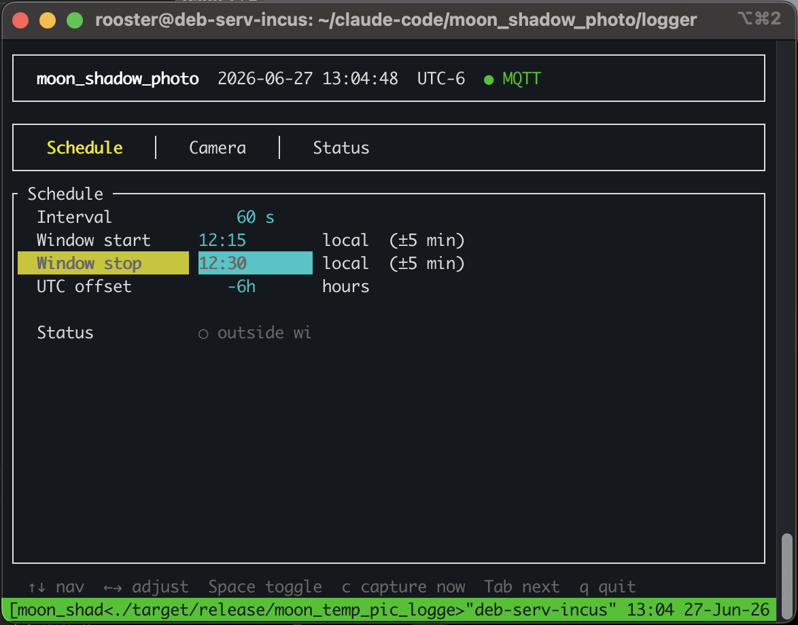
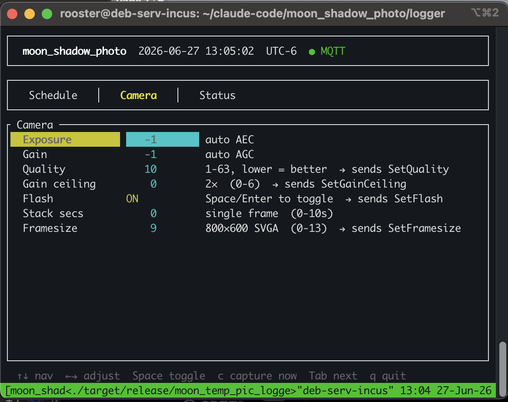

Periodic low-light photography using an **AI-Thinker ESP32-CAM-MB**. Firmware (Rust / ESP-IDF) wakes on an MQTT trigger, captures a JPEG, and HTTP POSTs it to a host logger. The host is a Rust binary with a terminal TUI running on a local server, managing the capture schedule and receiving photos over a plain TCP HTTP server.

```
┌──────────────────┐    MQTT senddata    ┌─────────────────────┐
│   logger TUI     │ ─────────────────▶  │  ESP32-CAM-MB       │
│   (debserver)    │                     │  OV2640 / 8MB PSRAM │
│   axum :8765     │ ◀───────────────── │  Rust / ESP-IDF     │
└──────────────────┘    HTTP POST JPEG   └─────────────────────┘
         │
         ▼
  ~/pic_logs/2026-06-27/
    20260627T020015Z_000.jpg
    20260627T021015Z_001.jpg …
```

---

## Firmware

Standard ESP Rust toolchain (`channel = "esp"`), ESP-IDF v5.3, `xtensa-esp32-espidf` target. Credentials live in a dedicated 4 KB config partition at `0x3F0000` — top of flash, safe from app growth — as a magic-header + length-prefixed JSON blob.

### Two-Thread MQTT

`EspMqttClient` deadlocks if `subscribe()` is called from the same thread as `connection.next()` — the ESP-IDF MQTT library holds an internal API lock during TCP receive. Fix: a background thread pumps the event loop over a channel to the main thread.

```rust
enum Ev {
    Connected,
    Received { topic: String, data: Vec<u8> },
    Disconnected,
    Fatal,
}

// Background thread — event pump
std::thread::Builder::new().stack_size(16384).spawn(move || {
    loop {
        match connection.next() {
            Ok(event) => {
                let ev = match event.payload() {
                    EventPayload::Connected(_)   => Some(Ev::Connected),
                    EventPayload::Disconnected   => Some(Ev::Disconnected),
                    EventPayload::Error(_)       => Some(Ev::Fatal),
                    EventPayload::Received { topic: Some(t), data, .. } =>
                        Some(Ev::Received { topic: t.to_string(), data: data.to_vec() }),
                    _ => None,
                };
                // event dropped here — before channel send
                if let Some(ev) = ev { let _ = tx.send(ev); }
            }
            Err(_) => { let _ = tx.send(Ev::Fatal); break; }
        }
    }
})?;
```

The event is decoded into owned heap data (`String`/`Vec<u8>`) and **dropped before the channel send** — the ESP-IDF event carries an internal buffer reference that cannot outlive the event callback, so the copy must happen inside the match.

### Camera on Core 1

The OV2640 DMA runs an ISR that fires continuously. On Core 0 it preempts the WiFi task's beacon handler, causing beacon timeouts that disconnect MQTT sessions mid-capture. Fix is one line in `sdkconfig.defaults`:

```
CONFIG_CAMERA_CORE1=y
```

Camera DMA stays on Core 1; WiFi stays on Core 0. MQTT sessions stay alive.

### Deferred Camera Init

Camera DMA flooding the ISR event queue during the TCP handshake caused `select()` timeouts on MQTT connect. Camera is now initialized only after the first `Ev::Connected` fires, and stays initialized across reconnects:

```rust
let mut cam_ready = false;
// …
Ev::Connected => {
    if !*cam_ready {
        camera::init(*rt_framesize, *rt_quality)?;
        *cam_ready = true;
    }
    client.subscribe(&senddata_topic, QoS::AtMostOnce)?;
    // …
}
```

### GRAB_LATEST — Camera DMA Mode

With the default `CAMERA_GRAB_WHEN_EMPTY`, the DMA ring has one slot. If idle JPEG frames overflow it, the DMA fills permanently — every subsequent `fb_get` times out and the camera is dead until reboot. Fix: two framebuffers + `GRAB_LATEST`, which overwrites the oldest buffer continuously so the DMA never stalls.

```rust
fn jpeg_config(framesize: u8, quality: u8) -> CameraConfig {
    make_config(framesize, quality, PIXFORMAT_JPEG, 2, CAMERA_GRAB_LATEST)
}
```

### PWDN Float After Deinit

After `esp_camera_deinit()`, the driver releases GPIO32 (PWDN) to high-Z. The AI-Thinker board has no external pullup, so the OV2640 never actually power-cycles — reinit reads stale mode registers and returns `0x106` (`ESP_ERR_NOT_SUPPORTED`). Fix: drive PWDN HIGH explicitly after every deinit, then wait 1000 ms before reinit.

```rust
fn hold_pwdn_high() {
    unsafe {
        let _ = esp_idf_sys::gpio_set_direction(32, gpio_mode_t_GPIO_MODE_OUTPUT);
        let _ = esp_idf_sys::gpio_set_level(32, 1);
    }
}
```

### Flash LED — Bypassed

The white flash LED (GPIO4) caused a boot loop during early development: a flash write bug left the config partition blank after erase, and every subsequent boot panicked on missing magic bytes. The underlying bug is fixed (stack-allocated DMA-safe write buffer), but flash is not needed for nighttime photography and has been disabled entirely. GPIO4 stays LOW.

---

## Logger

`moon_temp_pic_logger` runs on the local server. Two concurrent tasks: an **MQTT publisher** on a configurable schedule, and an **axum HTTP server** (port 8765) that receives JPEGs and saves them to a date-organized directory. Control is via a **ratatui terminal TUI**.

### Schedule Tab



Sets the capture window and interval. **Window start / stop** are local-time boundaries; the overnight wrap (e.g. 20:00–06:00) is handled automatically. Captures jitter ±5 min to avoid the same exact timestamp every night. Status shows `○ outside window` during the day; `● ACTIVE — next capture in Ns` when live.

### Camera Tab



Controls per-capture sensor settings sent in the `senddata` MQTT payload, and persistent device config pushed via `cmd` messages. Changes on the Camera tab are batched — pressing `s` sends all camera settings at once rather than one MQTT publish per keypress.

| Field | Sent as |
|---|---|
| Exposure, Gain, Stack secs | `senddata` payload (per-capture) |
| Quality, Gain ceiling, Framesize | `cmd` MQTT (persisted in firmware runtime state) |

---

## Low Light Settings

The OV2640 tops out at ~850 ms exposure (1200 AEC lines at SVGA). Single-frame results are good for moonlit scenes. Recommended starting points:

| Scene | Exposure | Gain | Gain ceiling | Notes |
|---|---|---|---|---|
| Bright moonlight | `-1` (auto) | `-1` (auto) | `0` (2×) | Let AEC/AGC find the balance |
| Moderate moonlight | `800` | `10` | `3` (16×) | ~560 ms, ~ISO 1000 equiv |
| Faint moonlight | `1200` | `20` | `6` (128×) | Max exposure, high gain, noisy |
| Full dark | `1200` | `30` | `6` (128×) | Max everything — usable but noisy |

Quality `10` (default) gives good detail at SVGA 800×600. Stack secs should be left at `0`.

### Frame Stacking

The firmware includes a frame-averaging stack — deinit, grayscale reinit, accumulate N frames, encode JPEG — but it is not expected to be used in normal operation. The reinit cycle adds ~3 seconds of overhead, and the software JPEG encoder path produces different color characteristics than the OV2640's hardware encoder. If longer effective exposure becomes a requirement it can be revisited, but more work would be needed to make it reliable.

---

## Source

```
firmware/src/
  main.rs     — WiFi, SNTP, two-thread MQTT loop, capture orchestration
  config.rs   — Flash-backed JSON config at 0x3F0000
  camera.rs   — Manual esp32-camera FFI (bindgen fails on macOS vs esp_camera.h)
  types.rs    — MQTT payload structs

logger/src/
  main.rs     — ratatui TUI, MQTT publisher, axum HTTP server, file save
  config.rs   — TOML config loader
```

Firmware: `git@github.com:rooster-ninja/moon_shadow_photo.git`  
Logger: `git@github.com:rooster-ninja/moon_shadow_pic_logger.git`
